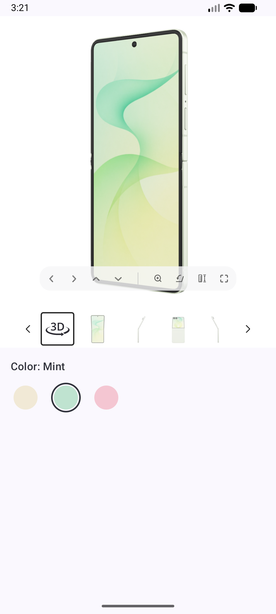

# Binkies 3D viewer in an iOS app (Swift / SwiftUI)

This is the Swift counterpart of [`kotlin-example-master`](../../../Downloads/kotlin-example-master): the same
product screen, putting the Binkies 3D viewer on a `WKWebView`. The app and the page talk to each other
through a small bridge:

- The app tells the page which product to show (`window.binkies.setSettings(...)`).
- The page tells the app whether the product has a 3D model, and reports its errors
  (`window.webkit.messageHandlers.BinkiesNative.postMessage(...)`).



All the code is in [`SwiftExample/BinkiesViewer.swift`](SwiftExample/BinkiesViewer.swift) and
[`SwiftExample/ContentView.swift`](SwiftExample/ContentView.swift). The reusable part is the `BinkiesViewer`
view and its `Coordinator`. `ContentView` and `ColorSelector` are only the demo around it.

## Run the example

1. Open `SwiftExample.xcodeproj` in Xcode (26 or newer).
2. Run the `SwiftExample` scheme on a simulator or device (iOS 16+).
3. Pick a color: Cream and Mint have a 3D model and the viewer slides open. Pink has no model, so the
   viewer stays collapsed and the label shows "(no 3D)".

## Add it to your app

1. No extra dependency and no `Info.plist` permission to add: `WebKit` is a system framework, and
   HTTPS requests work out of the box under App Transport Security.

2. Copy `BinkiesViewer.swift`, and set `viewerURL` to the viewer page you got from Binkies.

3. Give it a container that always sizes it at a real, non-zero width (never `if visible { BinkiesViewer(...) }`
   — see "Things to keep in mind" below) and animates its height between `0` and that size when
   collapsed/expanded, the same way `ViewerContainer` does in `ContentView.swift`:

   ```swift
   // nil until the page answers, then true (has 3D) or false (no 3D)
   @State private var visible: Bool?

   var body: some View {
       // GeometryReader at (or near) the root is the simplest way to get a real width to size the
       // viewer with; don't try to measure it from inside a view that's also being collapsed to 0.
       GeometryReader { proxy in
           let viewerHeight = proxy.size.width * 1.2

           BinkiesViewer(
               product: productId,   // Binkies content id of the selected variant
               visible: Binding(get: { visible == true }, set: { visible = $0 }),
           )
           .frame(width: proxy.size.width, height: viewerHeight, alignment: .top)
           .frame(height: visible == true ? viewerHeight : 0, alignment: .top)
           .clipped()
           .animation(.default, value: visible == true)
       }
   }
   ```

   When `productId` changes, the viewer switches the model without reloading the page.
   Keep `visible` in your screen state if other UI depends on it, e.g. a "3D" badge.

## How it works

```
App                                              Page (WKWebView)
 │  WKUserScript (.atDocumentStart):                │
 │    window.settings = {full settings}             │
 │  load(VIEWER_URL)                                │
 │ ──────────────────────────────────────────────▶  │  applies window.settings right away
 │                                                   │  and starts loading the product
 │  webView(_:didCommit:):                           │  window.binkies exists now
 │    window.binkies.setSettings({"product": ...})   │  (only changes something if the user
 │ ──────────────────────────────────────────────▶  │   picked another variant meanwhile)
 │                  {"type":"show"} or "hide"        │
 │ ◀──────────────────────────────────────────────  │
 │  window.binkies.setSettings({"product": "..."})   │  user picks another variant
 │ ──────────────────────────────────────────────▶  │
 │                  {"type":"show"} or "hide"        │  only if it changed
 │ ◀──────────────────────────────────────────────  │
 │                {"type":"error", ...}              │  whenever the page logs an error
 │ ◀──────────────────────────────────────────────  │
```

### Messages from the page

The page calls `window.webkit.messageHandlers.BinkiesNative.postMessage(json)`. The app registers that
handler with `WKUserContentController.add(_:name:)` **before** `load()`, because the page can post as
soon as it starts (`hide` on a device without WebGL2, or an error).

| Message                                          | Meaning                                                                                                                                                                             | What the app does                                                                             |
| ------------------------------------------------ | ------------------------------------------------------------------------------------------------------------------------------------------------------------------------------------- | --------------------------------------------------------------------------------------------- |
| `{"type":"show"}`                                | The selected product's 3D model has loaded.                                                                                                                                         | Expands the viewer.                                                                           |
| `{"type":"hide"}`                                | The selected product has no 3D model, or the device can't render 3D (no WebGL2).                                                                                                    | Collapses the viewer.                                                                         |
| `{"type":"error","message":"...","stack":"..."}` | The page logged an error: `console.error`, an uncaught error, an unhandled promise rejection or a failed script/image load. `stack` is only there when there was an `Error` object. | Logs it with `print`. Forward it to your crash reporting if you like. |

`show` and `hide` are only sent when the visibility changes. Switching from Cream to Mint sends nothing, because both have 3D.
The page remembers the answer per product, so switching back to a product answers right away.

### Settings sent to the page

The page gets its **first** settings before any of its scripts run: a `WKUserScript` with
`.atDocumentStart` injection sets `window.settings`, and the page applies it as soon as it starts. So it
starts loading the product right away, without a round trip to the app and without waiting for the 3D
viewer to load.

Later changes go through `window.binkies.setSettings(settings)` with `evaluateJavaScript`. `window.binkies`
exists once the page's first frame is visible, which the app gets as `WKNavigationDelegate.webView(_:didCommit:)`
— the Swift/WebKit equivalent of Android's `onPageCommitVisible`. There the app sends the current product once
(the user may have picked another variant while the page loaded), and after that every change. The page
deep-merges the object into its current settings, so you only send what changed, e.g.
`{"product": "samsung-galaxy-z-flip8-mint"}`.

| Setting                            | Type                              | Default     | Description                                |
| ----------------------------------- | ---------------------------------- | ----------- | ------------------------------------------- |
| `product`                          | string                            | `""`        | Binkies content id of the product to show. |
| `gallery.thumbnails.placement`     | `"bottom"`, `"left"` or `"right"` | `"bottom"`  | Where the thumbnail strip is placed.       |
| `gallery.thumbnails.selectedColor` | any CSS color                     | `"#262626"` | Border color of the selected thumbnail.    |

The page validates the settings strictly. Unknown keys (typos) and invalid values are rejected, and the
previous settings stay in place. `evaluateJavaScript`'s completion handler isn't used here, so `setSettings`
catches JS errors and logs them with `console.error`. The page sends that back as an `error` message, which
ends up in the console under the `[Binkies]` tag. Invalid start settings are reported the same way.

## Things to keep in mind

- **Never give the WKWebView a zero/collapsed size directly.** A WKWebView laid out at zero height pauses
  the page's rendering, so the next model never finishes loading and `show` never arrives. `ViewerContainer`
  instead keeps `BinkiesViewer` at its full `viewerHeight` (width × 1.2, pinned to the top) and animates the
  height of an outer, clipping container around it, exactly like the Kotlin example's clipping `Box`.
- **The page is loaded once.** `BinkiesViewer` is a `UIViewRepresentable`; SwiftUI keeps the same
  `WKWebView` instance (and the page's JS state) alive across re-renders of `ContentView`, and only
  `updateUIView` runs on product changes, just like `LaunchedEffect(product)` in the Kotlin version.
- **No Android-style `onPause`/`onResume`.** WKWebView doesn't expose an equivalent API; iOS suspends the
  app process (and with it the page's JS timers/rendering) automatically when it's backgrounded.
- **Viewer size.** The example uses the full width and a 5:6 aspect ratio (`width * 1.2`), which fits the
  model with the thumbnails below it. Change `viewerHeight` in `ViewerContainer` to fit your layout.
- **Measure the width from outside the collapsing view, not inside it.** A `GeometryReader` placed
  *inside* the view you're collapsing to `0` height measures `0`, because fixing a view's own frame to a
  state value that starts at `0` and then wrapping it in `.frame(maxWidth: .infinity)` doesn't make the
  outer frame report back the expanded width — the fixed frame always wins. `ContentView` reads the width
  once at the root with its own `GeometryReader` and passes it down as a plain value instead.

## Debugging

- With the simulator or a device connected and Web Inspector enabled (Settings → Safari → Advanced, on
  device), open Safari's Develop menu on the Mac to get DevTools for the page.
- Bridge messages and page errors are logged with `print`, tagged `[Binkies]`, visible in Xcode's console.
- On the page you can call `window.binkies.setSettings({...})` from DevTools and read the current settings
  from `window.binkies.settings`.
